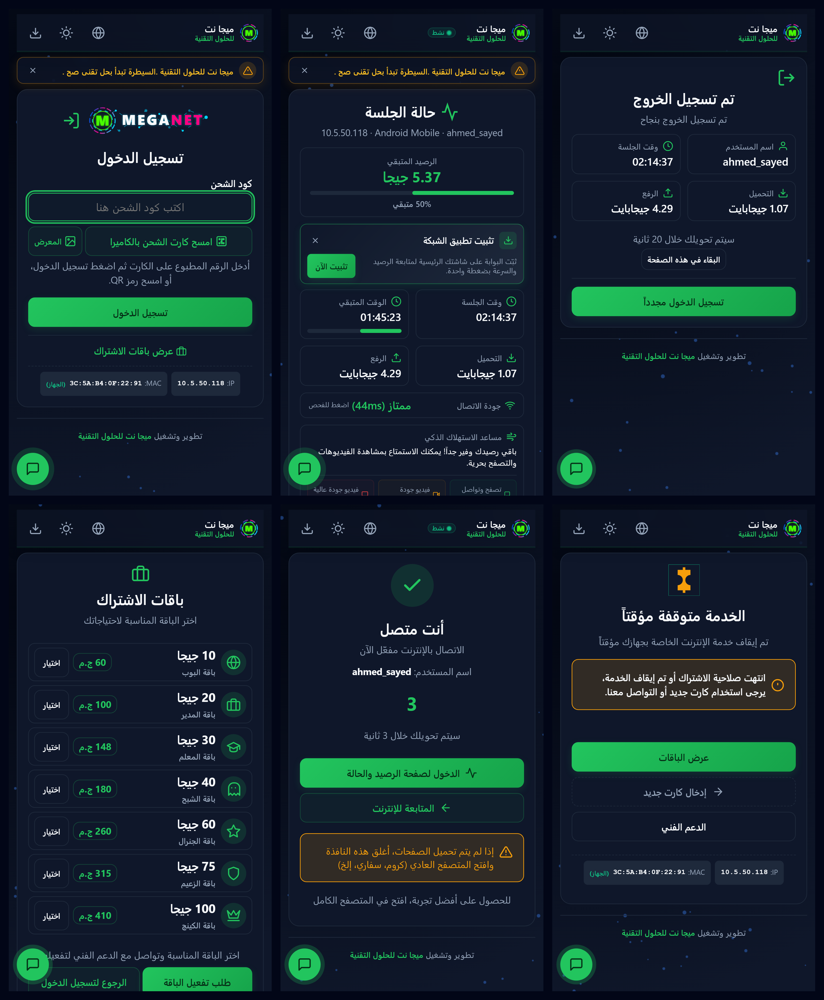

# بوابة هوتسبوت مايكروتك 2026 (MikroTik Hotspot Portal)

[English](README.md) | [العربية](README.ar.md)

> قالب صفحة هوتسبوت احترافي متكامل لراوترات مايكروتك (RouterOS v6 و v7)، عالي السرعة وبدون أي متطلبات أو مكتبات خارجية.

تم تصميم وبناء هذه البوابة وفق أعلى المعايير الحديثة لتوفير تجربة مستخدم (UX) فائقة السلاسة والسرعة على كافة الهواتف والأجهزة، متوافقة بنسبة 100% مع متصفحات تسجيل الدخول المقيدة (Captive Portals) مثل Apple iOS CNA و macOS و Android و Windows.

<p align="center">
  <br/>
  <strong>كل الصفحات — مظلم</strong>
</p>
<p align="center">
  <br/>
  <strong>كل الصفحات — مضيء</strong>
</p>
<p align="center">
  <br/>
  <strong>أوضاع تسجيل الدخول: كود شحن &middot; باقة &middot; مزدوج — مظلم</strong>
</p>
<p align="center">
  <br/>
  <strong>أوضاع تسجيل الدخول: كود شحن &middot; باقة &middot; مزدوج — مضيء</strong>
</p>

**أحدث إصدار: [v2.7.1](https://github.com/Mr-Muhamad/meganet-hotspot-portal/releases/latest)** — حزم مشتركة خفيفة (`portal.css` و `portal-*.js` لتقليص حجم `dist/` بأكثر من النصف إلى ~686 كيلوبايت)، مسح كروت مثبت ميدانيًا (`jsQR`)، دخول موضعي لروابط البيانات، تحذير مبكر بانتهاء الجلسة مع خروج تلقائي، نظام white-label كامل (12 شخصية + تخصيص الكلمات)، **وبرنامج Meganet Hotspot Studio (`.exe` / `npm run admin`)** المزوّد بالمحاكي المباشر (تكبير/تصغير `50%–150%`، مقبض سحب، تبديل الثيم داكن/نهاري عبر `hotspot_theme`، ومقاسات شاشات `340px` / `412px` / `768px`)، ومولّد الشعارات SVG، ومختبر QR الدخول، ومولّد سكربت `.rsc` (Option 114)، والرفع المباشر للراوتر عبر `/tool/fetch` مع حفظ إعدادات الراوتر لكل بروفايل (`mikrotik.json`).

---

## 🌟 أبرز المميزات

- **دخول فوري بمسح رمز الاستجابة السريعة:** نقرة واحدة تفتح كاميرا الهاتف الأصلية، وتُفك الصورة عبر مكتبة **jsQR** المدمجة (تقرأ صور الكاميرا الحقيقية للكروت الفعلية) مع مسار `BarcodeDetector` السريع حيثما توفر.
- **دعم نوعي الكروت معًا:** كروت الكود العاري (`=CODE` / `CODE`) تدخل تلقائيًا في مكانها، وكروت روابط mikhmon (`?username=X&password=Y`) تُستخرج بياناتها وتُرسل لبوابتنا مباشرة (محصّنة ضد اسم الدومين المطبوع القديم) مع احترام كلمة المرور الحاملة في كروت `up`.
- **اختيار صورة الكارت من المعرض (Gallery & Screenshots):** إمكانية رفع صورة الكارت أو لقطة الشاشة المستلمة عبر الواتساب في حال تعذر فتح الكاميرا.
- **لصق فوري للكود:** لصق الكود يرسل النموذج مباشرة؛ الكود المكتوب يدويًا يُرسل بزر الدخول أو Enter (الطول المتغير للأكواد يجعل الإرسال التلقائي للكتابة غير آمن).
- **حماية متقدمة ضد التصيد (Anti-Phishing & Safe QR Routing):** البوابة لا تغادر أبدًا بسبب حمولة ممسوحة — الروابط الحاملة لبيانات الدخول تُستهلك في مكانها، وغير الحاملة تُقصر على البوابة نفسها.
- **تحويل فوري في ثانية واحدة (`alogin.html`):** إتمام المصافحة مع الراوتر وتوجيه المستخدم للإنترنت في ثانية واحدة فقط.
- **دعم ثنائي اللغة كامل:** واجهة عربية أصيلة تدعم اتجاه اليمين لليسار (RTL)، مع إمكانية التبديل للغة الإنجليزية بنقرة واحدة.
- **توافق تام مع RouterOS v6 و v7:** استخدام آمن تماماً لمتغيرات مايكروتك `$(var)` مع حماية ضد هجمات الحقن XSS.
- **دعم طرق المصادقة:** يدعم تسجيل الدخول عبر الكروت (Voucher)، اسم المستخدم وكلمة المرور (PAP / CHAP مع تشفير MD5)، والماك أدرس.
- **بدون أي اعتمادات خارجية (Zero External Dependencies):** حجم كل صفحة HTML يتراوح بين ~20–43 كيلوبايت مع حزم مشتركة مستضافة محلياً على الراوتر (`portal.css`، `portal-core.js`، `portal-login.js`، `portal-status.js`) ليظل إجمالي `dist/` ~686 كيلوبايت ومناسباً لذاكرة الفلاش 1 ميجابايت بدون أي طلبات خارجية للخطوط أو الأيقونات أو الـ CDN.
- **مساعد الاستهلاك الذكي:** عرض مباشر ودقيق للرصيد المتبقي والوقت والتحميل والرفع وسرعة الاتصال في صفحة الحالة (`status.html`).

---

## 📁 هيكل المشروع

```
Meganet-New-hotspot/
├── config.json             # ملف الإعدادات: أسماء الشبكة، الألوان، الباقات، الدعم الفني
├── config.example.json     # نموذج إعدادات خالٍ من البيانات الشخصية للمشاركة
├── build.js                # محرك البناء: تصغير القوالب وتوليد الحزم المشتركة إلى dist/
├── md5.js                  # تشفير MD5 لمصادقة CHAP
├── admin/                  # خادم Studio المحلي وواجهته وأدوات .rsc والرفع ومولّد QR/SVG
├── desktop/                # غلاف تطبيق سطح المكتب Electron (Meganet Hotspot Studio)
├── src/
│   ├── templates/          # قوالب Nunjucks (login, status, alogin, logout, error...)
│   ├── css/                # ملفات التصميم → تُدمج في حزمة portal.css المشتركة
│   ├── js/modules/         # وحدات الجافاسكريبت → تُدمج في حزم portal-*.js المشتركة
│   ├── i18n/               # قواميس النصوص (ar.json / en.json)
│   ├── static/             # ملفات مايكروتك الثابتة (errors.txt, redirect.html, jsQR.js)
│   └── assets/             # الصور والشعارات
├── dist/                   # ★ المجلد النهائي الناتج — يُرفع هذا المجلد بالكامل إلى الراوتر
└── tests/                  # اختبارات الوحدة والتكامل (Jest) والاختبارات الشاملة (Playwright)
```

---

## 🚀 التثبيت والتشغيل السريع لمالكي الشبكات

### الطريقة الأولى: استخدام البرنامج التنفيذي المستقل (Meganet Hotspot Studio - الموصى بها)
لا تتطلب هذه الطريقة أي معرفة برمجية أو تثبيت Node.js:
1. توجه لمجلد `dist-app/` أو صفحة [الإصدارات الرسمية (Releases)](https://github.com/Mr-Muhamad/meganet-hotspot-portal/releases).
2. قم بتحميل وتشغيل **النسخة المحمولة** مباشرة بنقرة واحدة:
   - `Meganet Hotspot Studio-Portable-2.7.1.exe` (لا تحتاج تثبيت، يمكنك وضعها على فلاشة USB).
   - أو `Meganet Hotspot Studio-Setup-2.7.1.exe` (برنامج تثبيت رسمي ينشئ اختصارات على سطح المكتب وقائمة Start).
3. افتح البرنامج واستفد من أدوات **v2.7.1**:
   - **المحاكي المباشر المدمج:** تكبير/تصغير (`50%–150%`)، مقبض سحب لتغيير العرض، زر توسيع (`⛶`)، مبدّل ثيم داكن/نهاري (يتزامن مع كوكي `hotspot_theme`)، ومقاسات شاشات جاهزة (`340px` موبايل ضيق، `412px` موبايل عريض، `768px` تابلت).
   - **تخصيص الهوية والألوان:** 12 شخصية جاهزة + شخصيات مخصصة، فحص تباين WCAG 2.1 فوري، ومولّد الشعارات الذكي (`logo.svg` و `prand-title.svg` و `icon.png`)، ومختبر QR الدخول.
   - **تكامل مايكروتك المباشر:** مولّد سكربت `hotspot-setup.rsc` (مع DHCP Option 114 وقواعد Walled Garden)، ورفع مباشر لملفات البوابة والصور بالراوتر عبر REST API و `/tool/fetch` مع حفظ إعدادات كل راوتر في `mikrotik.json` (بدون حفظ كلمة المرور على القرص، وتضمين الإعدادات غير السرية عند تصدير/استيراد البروفايل).
   - اضغط **بناء وتحميل zip** للحصول على الحزمة الجاهزة ومراقبة مقياس ذاكرة الفلاش (1 MB).

### الطريقة الثانية: استخدام الحزمة الجاهزة مباشرة للراوتر
1. توجه إلى صفحة [الإصدارات الرسمية (Releases)](https://github.com/Mr-Muhamad/meganet-hotspot-portal/releases).
2. قم بتحميل الملف المضغوط `meganet-hotspot-dist-v2.7.1.zip` (أو بناء مجلد `dist/`).
3. فك الضغط عن الملف، وارفع محتوياته بالكامل (بما فيها `portal.css` و `portal-*.js` ومجلد `ar/`) إلى مجلد البوابة داخل راوتر مايكروتك عن طريق **FTP** أو **WinBox** (`Files`) أو ميزة الرفع المباشر من Studio.

### الطريقة الثالثة: التخصيص والبناء الذاتي للمطورين عبر سطر الأوامر
تحتاج إلى بيئة [Node.js](https://nodejs.org) (إصدار 16 فما فوق):

```bash
# 1. استنساخ المستودع
git clone https://github.com/Mr-Muhamad/meganet-hotspot-portal.git
cd meganet-hotspot-portal

# 2. تثبيت الحزم
npm install

# 3. تشغيل لوحة التحكم ومولد القوالب المكتبي
npm run app:dev       # تشغيل نافذة التطبيق المكتبي
npm run admin         # أو تشغيل خادم الإدارة المحلي وفتحه في المتصفح

# 4. إعادة بناء البرنامج التنفيذي المستقل (.exe)
npm run app:build

# 5. بناء وتوليد قالب الراوتر يدوياً
npm run build

# 6. تجربة البوابة محلياً على المتصفح مع محاكاة راوتروس
npm run preview
```

---

## ⚙️ التخصيص عبر `config.json`

يمكنك تعديل وتخصيص كل تفاصيل البوابة بدون لمس كود HTML/CSS من خلال ملف `config.json`:

- **بيانات الشبكة (`general`):** اسم الشبكة، اسم ورابط مطور الشبكة بالفوتر.
- **التصميم والألوان (`theme`):** اللون الأساسي (`primaryColor`)، لون الخلفية، استدارة الحواف، تفعيل خلفية الشبكة المتحركة.
- **الميزات والوظائف (`features`):**
  - `loginMode`: `voucher_only` (كروت فقط)، أو `normal_only` (يوزر وباسورد)، أو `both`.
  - `enableQRScanner`: تفعيل أو تعطيل زر مسح الكاميرا للـ QR.
  - `voucherMinLength`: تفعيل الإرسال التلقائي (OTP Auto-submit) عند عدد خانات محدد (مثلاً 4 أو 6 أرقام).
  - `enableSmartAssistant`: تفعيل حاسبة ومساعد الاستهلاك بصفحة الحالة.
- **الباقات والأسعار (`plans`):** إضافة أسعار وسعات الكروت لعرضها للمشتركين بصفحة الباقات.
- **فريق الدعم الفني (`support`):** أرقام الهواتف وحسابات الواتساب لتواصل المشتركين مع الدعم بنقرة واحدة.

---

## 🛡️ إعدادات الحديقة المسورة (Walled Garden) للمايكروتك

إذا قمت بتفعيل روابط الدعم الفني عبر واتساب، يُرجى إضافة هذه الأوامر في تيرمنال مايكروتك ليعمل التواصل حتى قبل تسجيل الدخول:

```routeros
/ip hotspot walled-garden ip add dst-host=wa.me action=accept comment="meganet-portal"
/ip hotspot walled-garden ip add dst-host=api.whatsapp.com action=accept comment="meganet-portal"
```

---

## 🧪 الاختبارات وضمان الجودة

المشروع مغطى بنسبة 100% باختبارات آلية لضمان خلوه التام من الأخطاء:

```bash
# فحص سلامة الأكواد والتنسيق بدون أي تحذيرات (0 errors, 0 warnings)
npm run lint

# تشغيل جميع اختبارات الوحدة والتكامل (Jest)
npm test

# التحقق من صحة القوالب وتوافقها مع محرك راوتروس
npm run validate

# تشغيل اختبارات التوافقية والمتصفحات وواجهة Studio (Playwright E2E)
npm run test:e2e
```

---

## 📄 الترخيص (License)

هذا المشروع مرخص تحت رخصة **[MIT License](LICENSE)** المفتوحة المصدر لعام 2026، وهو متاح للاستخدام الشخصي والتجاري والتطوير بحرية.

تطوير وإشراف: **[Mr-Muhamad](https://github.com/Mr-Muhamad)**
