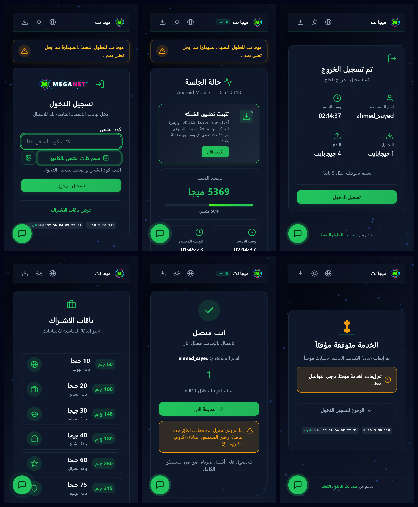
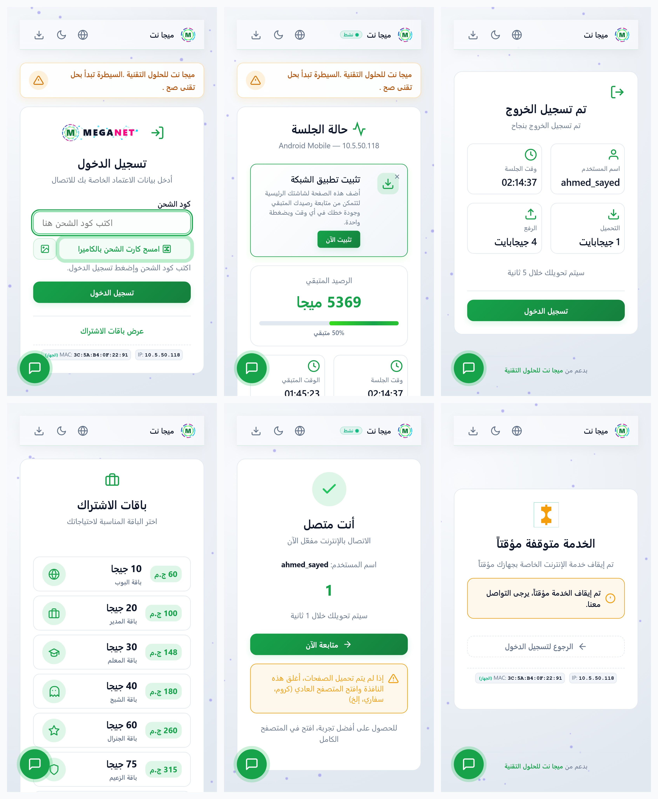
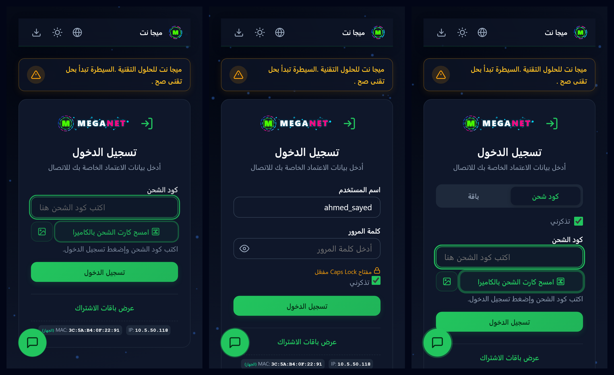
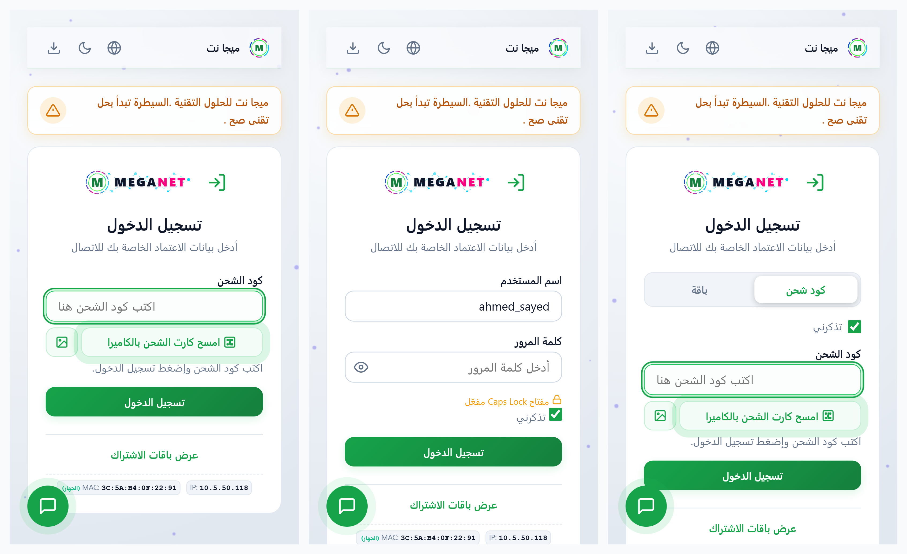

# بوابة هوتسبوت مايكروتك 2026 (MikroTik Hotspot Portal)

[English](README.md) | [العربية](README.ar.md)

> قالب صفحة هوتسبوت احترافي متكامل لراوترات مايكروتك (RouterOS v6 و v7)، عالي السرعة وبدون أي متطلبات أو مكتبات خارجية.

تم تصميم وبناء هذه البوابة وفق أعلى المعايير الحديثة لتوفير تجربة مستخدم (UX) فائقة السلاسة والسرعة على كافة الهواتف والأجهزة، متوافقة بنسبة 100% مع متصفحات تسجيل الدخول المقيدة (Captive Portals) مثل Apple iOS CNA و macOS و Android و Windows.

<p align="center">
  <br/>
  <strong>كل الصفحات — مظلم</strong>
</p>
<p align="center">
  <br/>
  <strong>كل الصفحات — مضيء</strong>
</p>
<p align="center">
  <br/>
  <strong>أوضاع تسجيل الدخول: كود شحن &middot; باقة &middot; مزدوج — مظلم</strong>
</p>
<p align="center">
  <br/>
  <strong>أوضاع تسجيل الدخول: كود شحن &middot; باقة &middot; مزدوج — مضيء</strong>
</p>

**أحدث إصدار: [v2.3.0](https://github.com/Mr-Muhamad/meganet-hotspot-portal/releases/latest)** — مسح كروت مثبت ميدانيًا (jsQR)، دخول موضعي لروابط البيانات، وتحذير مبكر بانتهاء الجلسة مع خروج تلقائي.

---

## 🌟 أبرز المميزات

- **دخول فوري بمسح رمز الاستجابة السريعة:** نقرة واحدة تفتح كاميرا الهاتف الأصلية، وتُفك الصورة عبر مكتبة **jsQR** المدمجة (تقرأ صور الكاميرا الحقيقية للكروت الفعلية) مع مسار `BarcodeDetector` السريع حيثما توفر.
- **دعم نوعي الكروت معًا:** كروت الكود العاري (`=CODE` / `CODE`) تدخل تلقائيًا في مكانها، وكروت روابط mikhmon (`?username=X&password=Y`) تُستخرج بياناتها وتُرسل لبوابتنا مباشرة (محصّنة ضد اسم الدومين المطبوع القديم) مع احترام كلمة المرور الحاملة في كروت `up`.
- **اختيار صورة الكارت من المعرض (Gallery & Screenshots):** إمكانية رفع صورة الكارت أو لقطة الشاشة المستلمة عبر الواتساب في حال تعذر فتح الكاميرا.
- **لصق فوري للكود:** لصق الكود يرسل النموذج مباشرة؛ الكود المكتوب يدويًا يُرسل بزر الدخول أو Enter (الطول المتغير للأكواد يجعل الإرسال التلقائي للكتابة غير آمن).
- **حماية متقدمة ضد التصيد (Anti-Phishing & Safe QR Routing):** البوابة لا تغادر أبدًا بسبب حمولة ممسوحة — الروابط الحاملة لبيانات الدخول تُستهلك في مكانها، وغير الحاملة تُقصر على البوابة نفسها.
- **تحويل فوري في ثانية واحدة (`alogin.html`):** إتمام المصافحة مع الراوتر وتوجيه المستخدم للإنترنت في ثانية واحدة فقط.
- **دعم ثنائي اللغة كامل:** واجهة عربية أصيلة تدعم اتجاه اليمين لليسار (RTL)، مع إمكانية التبديل للغة الإنجليزية بنقرة واحدة.
- **توافق تام مع RouterOS v6 و v7:** استخدام آمن تماماً لمتغيرات مايكروتك `$(var)` مع حماية ضد هجمات الحقن XSS.
- **دعم طرق المصادقة:** يدعم تسجيل الدخول عبر الكروت (Voucher)، اسم المستخدم وكلمة المرور (PAP / CHAP مع تشفير MD5)، والماك أدرس.
- **بدون أي اعتمادات خارجية (Zero External Dependencies):** حجم الصفحة أقل من 150 كيلوبايت، وتعمل بكفاءة تامة دون الحاجة لاتصال إنترنت لتحميل خطوط أو أيقونات أو ملفات CSS خارجية.
- **مساعد الاستهلاك الذكي:** عرض مباشر ودقيق للرصيد المتبقي والوقت والتحميل والرفع وسرعة الاتصال في صفحة الحالة (`status.html`).

---

## 📁 هيكل المشروع

```
Meganet-New-hotspot/
├── config.json             # ملف الإعدادات: أسماء الشبكة، الألوان، الباقات، الدعم الفني
├── config.example.json     # نموذج إعدادات خالي من البيانات الشخصية للمشاركة
├── build.js                # محرك البناء: دمج وتصغير القوالب والـ CSS/JS إلى مجلد dist/
├── md5.js                  # تشفير MD5 لمصادقة CHAP
├── src/
│   ├── templates/          # قوالب Nunjucks (login, status, alogin, logout, error...)
│   ├── css/                # ملفات التصميم والأنماط (theme, layout, components...)
│   ├── js/modules/         # وحدات الجافاسكريبت (auth, qr-scanner, status, ui...)
│   ├── i18n/               # قواميس النصوص (ar.json / en.json)
│   ├── static/             # ملفات مايكروتك الثابتة (errors.txt, redirect.html)
│   └── assets/             # الصور والشعارات
├── dist/                   # ★ المجلد النهائي الناتج — يُرفع هذا المجلد بالكامل إلى الراوتر
└── tests/                  # اختبارات الوحدة (Jest) والاختبارات الشاملة (Playwright)
```

---

## 🚀 التثبيت والتشغيل السريع لمالكي الشبكات

### الطريقة الأولى: استخدام الحزمة الجاهزة مباشرة (بدون Node.js)
1. توجه إلى صفحة [الإصدارات الرسمية (Releases)](https://github.com/Mr-Muhamad/meganet-hotspot-portal/releases).
2. قم بتحميل الملف المضغوط `meganet-hotspot-dist-v2.0.0.zip`.
3. فك الضغط عن الملف، وارفع محتوياته مباشرة إلى مجلد `hotspot` داخل راوتر مايكروتك عن طريق بروتوكول **FTP** أو برنامج **WinBox** (قسم `Files`).

### الطريقة الثانية: التخصيص والبناء الذاتي للمطورين
تحتاج إلى بيئة [Node.js](https://nodejs.org) (إصدار 16 فما فوق):

```bash
# 1. استنساخ المستودع
git clone https://github.com/Mr-Muhamad/meganet-hotspot-portal.git
cd meganet-hotspot-portal

# 2. تثبيت الحزم
npm install

# 3. تعديل الإعدادات
# قم بنسخ config.example.json إلى config.json وعدل ألوانك، اسم شبكتك، وباقاتك
cp config.example.json config.json

# 4. بناء المشروع
npm run build

# 5. تجربة البوابة محلياً على المتصفح
npm run preview
```

---

## ⚙️ التخصيص عبر `config.json`

يمكنك تعديل وتخصيص كل تفاصيل البوابة بدون لمس كود HTML/CSS من خلال ملف `config.json`:

- **بيانات الشبكة (`general`):** اسم الشبكة، اسم ورابط مطور الشبكة بالفوتر.
- **التصميم والألوان (`theme`):** اللون الأساسي (`primaryColor`)، لون الخلفية، استدارة الحواف، تفعيل خلفية الشبكة المتحركة.
- **الميزات والوظائف (`features`):**
  - `loginMode`: `voucher_only` (كروت فقط)، أو `normal_only` (يوزر وباسورد)، أو `both`.
  - `enableQRScanner`: تفعيل أو تعطيل زر مسح الكاميرا للـ QR.
  - `voucherMinLength`: تفعيل الإرسال التلقائي (OTP Auto-submit) عند عدد خانات محدد (مثلاً 4 أو 6 أرقام).
  - `enableSmartAssistant`: تفعيل حاسبة ومساعد الاستهلاك بصفحة الحالة.
- **الباقات والأسعار (`plans`):** إضافة أسعار وسعات الكروت لعرضها للمشتركين بصفحة الباقات.
- **فريق الدعم الفني (`support`):** أرقام الهواتف وحسابات الواتساب لتواصل المشتركين مع الدعم بنقرة واحدة.

---

## 🛡️ إعدادات الحديقة المسورة (Walled Garden) للمايكروتك

إذا قمت بتفعيل روابط الدعم الفني عبر واتساب، يُرجى إضافة هذه الأوامر في تيرمنال مايكروتك ليعمل التواصل حتى قبل تسجيل الدخول:

```routeros
/ip hotspot walled-garden ip add dst-host=wa.me action=accept comment="meganet-portal"
/ip hotspot walled-garden ip add dst-host=api.whatsapp.com action=accept comment="meganet-portal"
```

---

## 🧪 الاختبارات وضمان الجودة

المشروع مغطى بنسبة 100% باختبارات آلية لضمان عدم حدوث أي انهيار:

```bash
# تشغيل جميع اختبارات الوحدة (183 اختبار)
npm test

# تشغيل اختبارات التحقق من التوافقية والمتصفحات (Playwright E2E)
npm run test:e2e
```

---

## 📄 الترخيص (License)

هذا المشروع مرخص تحت رخصة **[MIT License](LICENSE)** المفتوحة المصدر لعام 2026، وهو متاح للاستخدام الشخصي والتجاري والتطوير بحرية.

تطوير وإشراف: **[Mr-Muhamad](https://github.com/Mr-Muhamad)**
