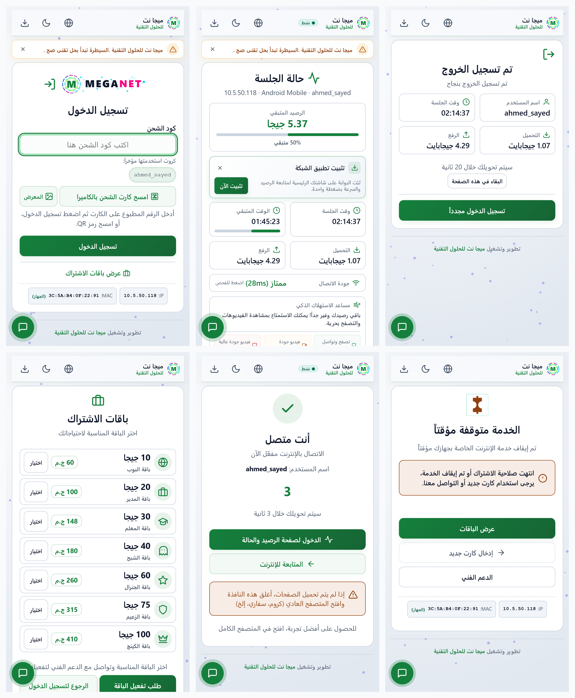
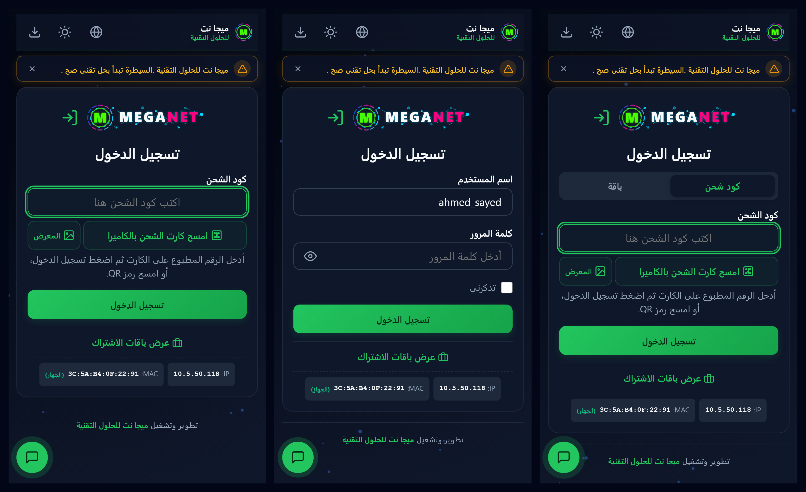
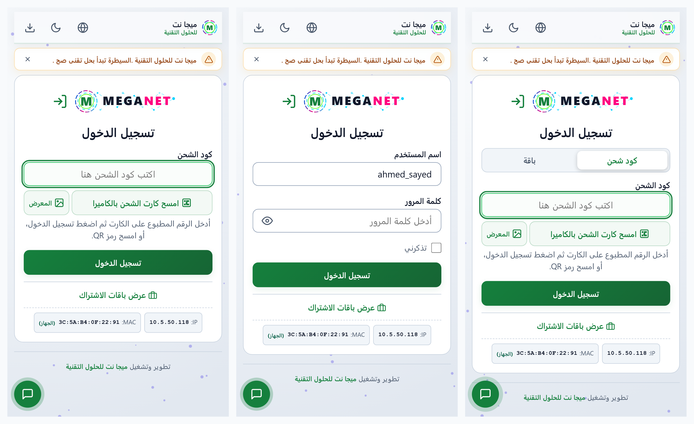
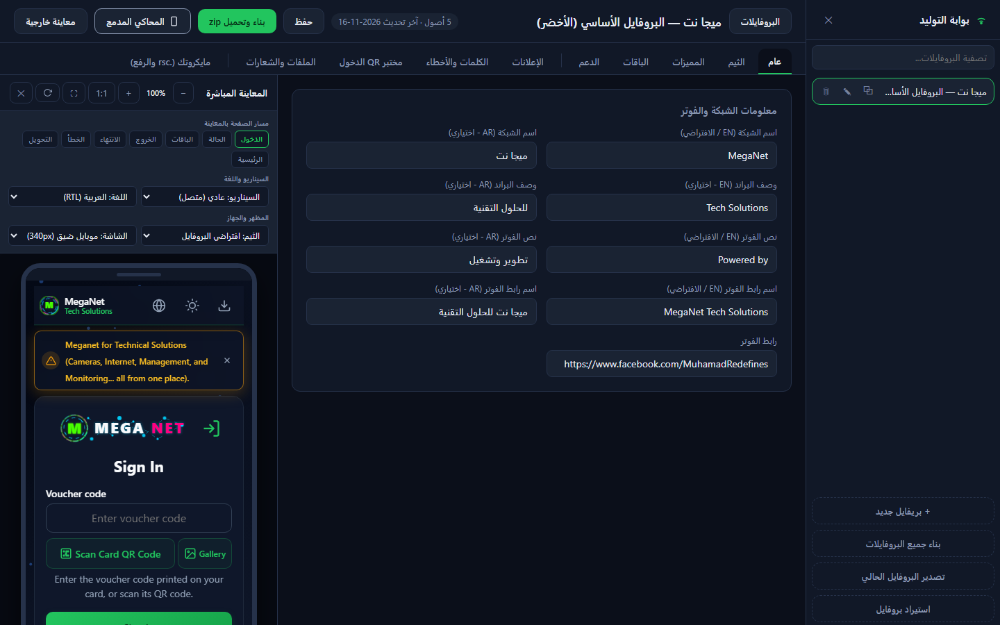

# بوابة هوتسبوت مايكروتك 2026 (MikroTik Hotspot Portal)

[English](README.md) | [العربية](README.ar.md)

> قالب صفحة هوتسبوت احترافي متكامل لراوترات مايكروتك (RouterOS v6 و v7)، عالي السرعة وبدون أي متطلبات أو مكتبات خارجية.

تم تصميم وبناء هذه البوابة وفق أعلى المعايير الحديثة لتوفير تجربة مستخدم (UX) فائقة السلاسة والسرعة على كافة الهواتف والأجهزة، متوافقة بنسبة 100% مع متصفحات تسجيل الدخول المقيدة (Captive Portals) مثل Apple iOS CNA و macOS و Android و Windows.

<p align="center">
  <br/>
  <strong>كل الصفحات — مظلم</strong>
</p>
<p align="center">
  <br/>
  <strong>كل الصفحات — مضيء</strong>
</p>
<p align="center">
  <br/>
  <strong>أوضاع تسجيل الدخول: كود شحن &middot; باقة &middot; مزدوج — مظلم</strong>
</p>
<p align="center">
  <br/>
  <strong>أوضاع تسجيل الدخول: كود شحن &middot; باقة &middot; مزدوج — مضيء</strong>
</p>
<p align="center">
  <br/>
  <strong>Meganet Hotspot Studio — المحاكي المباشر، نشر مايكروتك v6 FTP و v7، ومختبر QR الدخول</strong>
</p>

**أحدث إصدار: [v2.8.0](https://github.com/Mr-Muhamad/Meganet-hotspot-portal/releases)** — إصداران منفصلان برقم البناء: **[حزمة البوابة (`portal-v2.8.0-build.*`)](https://github.com/Mr-Muhamad/Meganet-hotspot-portal/releases/tag/portal-v2.8.0-build.126)** (حجم `dist/` ~696 كيلوبايت جاهزة للرفع على الراوتر) و **[تطبيق الاستوديو (`studio-v2.8.0-build.*`)](https://github.com/Mr-Muhamad/Meganet-hotspot-portal/releases/tag/studio-v2.8.0-build.127)** (`.exe` / `npm run admin`). يتميز بسجل **آخر 3 كروت** المقاوم لـ WebView (مُزامَن عبر Cookie و `sessionStorage` و `localStorage` وصفحة الحالة)، ووصف البراند بسطرين في الهيدر مع شريط تثبيت PWA مضغوط للموبايل، وتغيير الكارت المباشر (`erase-cookie=on`)، ونقاط بيع الكروت وواتساب الباقات المستقل (`outlets` و `plansWhatsapp`)، ومنظومة مسح QR مطوّرة (`BarcodeDetector` بالقص المركزي + `jsQR` بتمريرة تحسين التباين وإعادة المحاولة التلقائية)، و12 شخصية جاهزة، ومولّد الشعارات SVG، والرفع المباشر لمايكروتك (**RouterOS v6 FTP** و **v7 REST/`/tool/fetch`**).

---

## 🌟 أبرز المميزات

- **سجل آخر 3 كروت متوافق مع WebView:** أزرار سريعة لآخر 3 كروت أسفل خانة الكود، محفوظة عبر `Cookie` (30 يوماً) و `sessionStorage` و `localStorage` مع المزامنة في `status.html` لتعمل بسلاسة داخل Android CaptivePortalLogin WebView و iOS CNA والمتصفحات العادية.
- **دخول فوري بمسح رمز الاستجابة السريعة (QR):** نقرة واحدة تفتح كاميرا الهاتف الأصلية بدون صلاحيات HTTPS؛ وتُفك الصورة بمسار `BarcodeDetector` الأصلي (مع قص مركزي 1:1 للصور الكبيرة) يليه محرك **jsQR** (`1.4.0`) متعدد المقاييس ومربعات 1:1، مع تمريرة أخيرة لتحسين التباين (`_enhanceContrast`) للصور الباهتة أو ذات الانعكاس، وإعادة تحميل تلقائية للمحرك عند تعثر الشبكة.
- **دعم جميع صيغ كروت الـ QR معًا:** الكود العاري أو المسبوق بـ `=` (`CODE` / `=CODE`)، وكروت الباسورد الفارغ (`-CODE`)، وكروت اليوزر والباسورد المضغوطة بحرف الطول (`[a-z]<user><pass>` حيث `a=1..z=26` يحدد طول اليوزر)، وروابط mikhmon (`?username=X&password=Y`) — تدخل جميعها تلقائيًا في مكانها مع احترام كلمة المرور الفعلية أو الفارغة.
- **اختيار صورة الكارت من المعرض (Gallery & Screenshots):** إمكانية رفع صورة الكارت أو لقطة الشاشة المستلمة عبر الواتساب في حال تعذر فتح الكاميرا.
- **تبديل الكارت وتجربة `alogin.html`:** زر تغيير الكارت في صفحة الحالة يسجّل الخروج مع مسح الكوكي (`erase-cookie=on`) ليعود مباشرة إلى صفحة الدخول، وتعرض `alogin.html` زري الرصيد والحالة والمتابعة للإنترنت بشكل واضح.
- **صفحة الباقات ونقاط البيع (`plans.html`):** عرض الباقات والأسعار مع **نقاط بيع الكروت** (`support.outlets`) ورابط واتساب مستقل لطلبات التفعيل (`support.plansWhatsapp`).
- **حماية متقدمة ضد التصيد (Anti-Phishing & Safe QR Routing):** البوابة لا تغادر أبدًا بسبب حمولة ممسوحة — الروابط الحاملة لبيانات الدخول تُستهلك في مكانها، وغير الحاملة تُقصر على البوابة نفسها.
- **دعم ثنائي اللغة كامل وتخصيص البراند:** واجهة عربية (RTL) وإنجليزية (LTR) مع سطر وصف اختياري تحت اسم الشبكة (`brandTagline`) وتوافق تام مع **RouterOS v6 و v7** (`CHAP` / `PAP`).
- **بدون أي اعتمادات خارجية (Zero External Dependencies):** حجم صفحات HTML يتراوح بين ~18–48 كيلوبايت مع حزم مشتركة مستضافة محلياً (`portal.css` ~53 كيلوبايت و `portal-*.js` ~80 كيلوبايت) ليظل إجمالي `dist/` ~696 كيلوبايت (31 ملفاً) ومناسباً لذاكرة الفلاش 1 ميجابايت.
- **مساعد الاستهلاك الذكي:** عرض مباشر ودقيق للرصيد المتبقي والوقت والتحميل والرفع وسرعة الاتصال في صفحة الحالة (`status.html`).

---

## 📁 هيكل المشروع

```
Meganet-New-hotspot/
├── config.json             # ملف الإعدادات: أسماء الشبكة، الألوان، الباقات، الدعم الفني
├── config.example.json     # نموذج إعدادات خالٍ من البيانات الشخصية للمشاركة
├── build.js                # محرك البناء: تصغير القوالب وتوليد الحزم المشتركة إلى dist/
├── md5.js                  # تشفير MD5 لمصادقة CHAP
├── admin/                  # خادم Studio المحلي وواجهته وأدوات .rsc والرفع ومولّد QR/SVG
├── desktop/                # غلاف تطبيق سطح المكتب Electron (Meganet Hotspot Studio)
├── src/
│   ├── templates/          # قوالب Nunjucks (login, status, alogin, logout, error...)
│   ├── css/                # ملفات التصميم → تُدمج في حزمة portal.css المشتركة
│   ├── js/modules/         # وحدات الجافاسكريبت → تُدمج في حزم portal-*.js المشتركة
│   ├── i18n/               # قواميس النصوص (ar.json / en.json)
│   ├── static/             # ملفات مايكروتك الثابتة (errors.txt, redirect.html, jsQR.js)
│   └── assets/             # الصور والشعارات
├── dist/                   # ★ المجلد النهائي الناتج — يُرفع هذا المجلد بالكامل إلى الراوتر
└── tests/                  # اختبارات الوحدة والتكامل (Jest) والاختبارات الشاملة (Playwright)
```

---

## 🚀 التثبيت والتشغيل السريع لمالكي الشبكات

### الطريقة الأولى: استخدام البرنامج التنفيذي المستقل (Meganet Hotspot Studio - الموصى بها)
لا تتطلب هذه الطريقة أي معرفة برمجية أو تثبيت Node.js:
1. توجه لمجلد `dist-app/` أو صفحة [الإصدارات الرسمية للاستوديو (`studio-v2.8.0-build.*`)](https://github.com/Mr-Muhamad/Meganet-hotspot-portal/releases).
2. قم بتحميل وتشغيل **النسخة المحمولة** أو المثبت برقم البناء:
   - `Meganet.Hotspot.Studio-Portable-2.8.0-build.<N>.exe` (لا تحتاج تثبيت، يمكنك وضعها على فلاشة USB).
   - أو `Meganet.Hotspot.Studio-Setup-2.8.0-build.<N>.exe` (برنامج تثبيت رسمي ينشئ اختصارات على سطح المكتب وقائمة Start).
3. افتح البرنامج واستفد من أدوات **v2.8.0**:
   - **المحاكي المباشر المدمج:** تكبير/تصغير (`50%–150%`)، مقبض سحب لتغيير العرض، زر توسيع (`⛶`)، مبدّل ثيم داكن/نهاري (يتزامن مع كوكي `hotspot_theme`)، ومقاسات شاشات جاهزة (`340px` موبايل ضيق، `412px` موبايل عريض، `768px` تابلت).
   - **تخصيص الهوية والألوان والباقات:** 12 شخصية جاهزة + شخصيات مخصصة، وصف البراند بسطرين (`brandTagline`)، فحص تباين WCAG 2.1 فوري، مولّد الشعارات الذكي (`logo.svg` و `prand-title.svg` و `icon.png`)، نقاط بيع الكروت (`outlets`) وواتساب الباقات (`plansWhatsapp`)، ومختبر QR الدخول.
   - **تكامل مايكروتك المباشر (v6 و v7):** رفع مباشر لملفات البوابة والصور عبر **FTP لـ RouterOS v6** و **REST API / `/tool/fetch` لـ RouterOS v7**، مع مولّد سكربت `hotspot-setup.rsc` (DHCP Option 114 وقواعد Walled Garden) وحفظ إعدادات كل راوتر في `mikrotik.json` بدون حفظ كلمة المرور على القرص.
   - اضغط **بناء وتحميل zip** للحصول على الحزمة الجاهزة ومراقبة مقياس ذاكرة الفلاش (1 MB).

### الطريقة الثانية: استخدام حزمة البوابة الجاهزة مباشرة للراوتر
1. توجه إلى صفحة [إصدار البوابة المستقل (`portal-v2.8.0-build.*`)](https://github.com/Mr-Muhamad/Meganet-hotspot-portal/releases).
2. قم بتحميل الملف المضغوط `Meganet-Hotspot-Portal-v2.8.0-build.<N>.zip` (أو توليدها محلياً عبر `npm run portal:package`).
3. فك الضغط عن الملف، وارفع محتوياته بالكامل (بما فيها `portal.css` و `portal-*.js` ومجلد `ar/`) إلى مجلد البوابة داخل راوتر مايكروتك عن طريق **FTP** أو **WinBox** (`Files`) أو ميزة الرفع المباشر من Studio.

### الطريقة الثالثة: التخصيص والبناء الذاتي للمطورين عبر سطر الأوامر
تحتاج إلى بيئة [Node.js](https://nodejs.org) (إصدار 18 فما فوق):

```bash
# 1. استنساخ المستودع
git clone https://github.com/Mr-Muhamad/Meganet-hotspot-portal.git
cd Meganet-hotspot-portal

# 2. تثبيت الحزم
npm install

# 3. تشغيل لوحة التحكم ومولد القوالب المكتبي
npm run app:dev             # تشغيل نافذة التطبيق المكتبي
npm run admin               # أو تشغيل خادم الإدارة المحلي وفتحه في المتصفح

# 4. إعادة بناء حزم البوابة والاستوديو مع رقم البناء
npm run portal:package      # توليد أرشيف البوابة في dist-release/
npm run app:build:numbered  # بناء نسختي الويندوز للاستوديو في dist-app/
npm run app:build           # بناء قياسي بدون رقم بناء

# 5. بناء وتوليد قالب الراوتر يدوياً (يرجع إلى config.example.json عند غياب config.json)
npm run build

# 6. تجربة البوابة محلياً على المتصفح مع محاكاة راوتروس
npm run preview
```

---

## ⚙️ التخصيص عبر `config.json`

يمكنك تعديل وتخصيص كل تفاصيل البوابة بدون لمس كود HTML/CSS من خلال ملف `config.json`:

- **بيانات الشبكة (`general`):** اسم الشبكة، وصف البراند (`brandTagline` / `brandTagline_ar` على سطر ثانٍ في الهيدر)، واسم ورابط مطور الشبكة بالفوتر.
- **التصميم والألوان (`theme`):** الشخصية (`preset` من بين 12 قالباً جاهزاً أو مخصص)، الثيم الافتراضي (`defaultTheme`)، اللون الأساسي (`primaryColor`)، لون الخلفية، استدارة الحواف، تفعيل خلفية الشبكة المتحركة.
- **الميزات والوظائف (`features`):**
  - `loginMode`: `voucher_only` (كروت فقط)، أو `normal_only` (يوزر وباسورد)، أو `both`.
  - `voucherFormat`: صيغة الكود (`numeric` أرقام فقط أو `alphanumeric` حروف وأرقام).
  - `enableQRScanner`: تفعيل أو تعطيل زر مسح الكاميرا للـ QR.
  - `voucherMinLength`: الحد الأدنى لطول كود الشحن (مثلاً 4 خانات) لرفض الأكواد القصيرة قبل الإرسال إلى الراوتر.
  - `enableSmartAssistant`: تفعيل حاسبة ومساعد الاستهلاك بصفحة الحالة.
- **الباقات والأسعار (`plans`):** إضافة أسعار وسعات الكروت لعرضها للمشتركين بصفحة الباقات.
- **فريق الدعم الفني ونقاط البيع (`support`):** أرقام الهواتف والواتساب، **ونقاط بيع الكروت (`outlets`)**، وواتساب مخصص لتفعيل الباقات (`plansWhatsapp`).

---

## 🛡️ إعدادات الحديقة المسورة (Walled Garden) للمايكروتك

إذا قمت بتفعيل روابط الدعم الفني عبر واتساب، يُرجى إضافة هذه الأوامر في تيرمنال مايكروتك ليعمل التواصل حتى قبل تسجيل الدخول:

```routeros
/ip hotspot walled-garden ip add dst-host=wa.me action=accept comment="meganet-portal"
/ip hotspot walled-garden ip add dst-host=api.whatsapp.com action=accept comment="meganet-portal"
```

---

## 🧪 الاختبارات وضمان الجودة

المشروع مغطى بنسبة 100% باختبارات آلية لضمان خلوه التام من الأخطاء:

```bash
# فحص سلامة الأكواد والتنسيق بدون أي تحذيرات (0 errors, 0 warnings)
npm run lint

# تشغيل جميع اختبارات الوحدة والتكامل (Jest)
npm test

# التحقق من صحة القوالب وتوافقها مع محرك راوتروس
npm run validate

# تشغيل اختبارات التوافقية والمتصفحات وواجهة Studio (Playwright E2E)
npm run test:e2e
```

---

## 📄 الترخيص (License)

هذا المشروع مرخص تحت رخصة **[MIT License](LICENSE)** المفتوحة المصدر لعام 2026، وهو متاح للاستخدام الشخصي والتجاري والتطوير بحرية.

تطوير وإشراف: **[Mr-Muhamad](https://github.com/Mr-Muhamad)**
